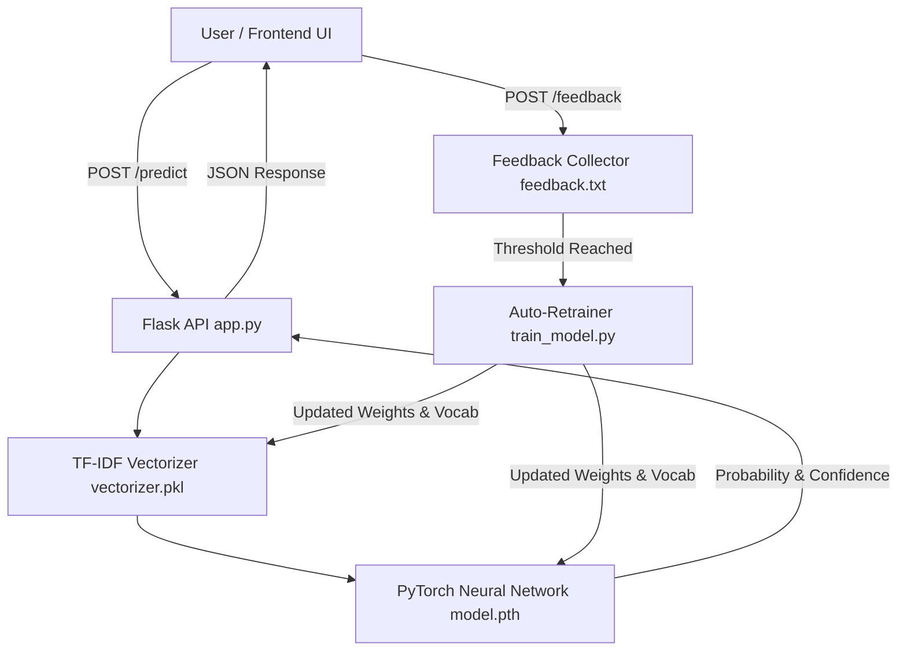

# 🕷️ Spider-Sense // AI Text Analysis System

[](https://www.python.org/)
[](https://flask.palletsprojects.com/)
[](https://pytorch.org/)
[](https://scikit-learn.org/)

**Spider-Sense** is a machine-learning text analysis and classification system designed to detect AI-generated vs. human-written text. Inspired by Spider-Man's intuition, it tingles when artificial patterns are detected in writing.

The system features an automated **human-in-the-loop continuous retraining pipeline**, where user corrections dynamically refine and update the PyTorch neural network.

---

## 🌟 Key Features

- **⚡ Real-Time AI Detection**: Classifies text as AI-generated or human-written with confidence percentages.
- **🧠 PyTorch Neural Network**: Multi-layer perceptron trained on TF-IDF features with dropout regularization.
- **🔄 Active Learning Feedback Loop**: Users can submit corrections (Human / AI). When the feedback threshold is met, the system automatically triggers background model retraining.
- **🌐 Responsive Cyberpunk UI**: Sleek, spider-themed interface with radar scanlines, real-time counters, and animated feedback cards.
- **🚀 Flexible Deployment**:
  - Run completely locally via Flask (`python app.py`).
  - Deploy frontend to **GitHub Pages**.
  - Deploy backend API to **Render** or any container host with Gunicorn.

---

## 🏗️ System Architecture



---

## 🚀 Quick Start

### 1. Clone the Repository
```bash
git clone https://github.com/anjanmishra1/BitNBuild.git
cd BitNBuild
```

### 2. Install Dependencies
```bash
pip install -r requirements.txt
```

### 3. Run the Application
```bash
python app.py
```
Open **[http://localhost:5000](http://localhost:5000)** in your browser. The web UI will load and automatically connect to your local backend.

---

## 🧪 Training the Model Manually

To retrain the PyTorch model from scratch on `dataset.txt` (and any accumulated feedback in `feedback.txt`):

```bash
python train_model.py
```

This will:
1. Load `dataset.txt` and `feedback.txt`.
2. Extract n-gram TF-IDF text features.
3. Split into Train (80%), Validation (10%), and Test (10%) sets.
4. Train the `TextClassifier` neural network for 1,000 epochs.
5. Evaluate Test Accuracy, Precision, Recall, and F1 Score.
6. Save the trained weights to `model.pth` and `vectorizer.pkl`.

---

## 📡 API Reference

### 1. Predict Text
**Endpoint:** `POST /predict`  
**Content-Type:** `application/json`

**Request:**
```json
{
  "text": "Artificial intelligence and machine learning algorithms are rapidly evolving across multiple domains."
}
```

**Response (200 OK):**
```json
{
  "result": "AI-generated",
  "confidence": 99.98,
  "ai_probability": 99.98
}
```

---

### 2. Submit Feedback (Continuous Learning)
**Endpoint:** `POST /feedback`  
**Content-Type:** `application/json`

**Request:**
```json
{
  "text": "Hey what's up, let's grab coffee tomorrow morning!",
  "correct_label": "human"
}
```

**Response (200 OK):**
```json
{
  "success": true,
  "message": "Feedback saved.",
  "feedback_count": 6,
  "remaining_until_retrain": 0,
  "retraining": true
}
```

---

### 3. Health & Status
**Endpoint:** `GET /health`

**Response (200 OK):**
```json
{
  "status": "online",
  "model": "Spider-Sense",
  "model_loaded": true,
  "device": "cpu",
  "feedback_count": 6,
  "retraining": false
}
```

---

## 📁 Repository Structure

```
BitNBuild/
├── app.py                  # Flask server with REST API & UI rendering
├── train_model.py          # PyTorch training & evaluation pipeline
├── dataset.py              # Baseline dataset processing & training reference
├── dataset.txt             # Primary training corpus (labeled AI & Human text)
├── feedback.txt            # Human-in-the-loop collected feedback dataset
├── model.pth               # Trained PyTorch neural network weights
├── vectorizer.pkl          # Scikit-learn TF-IDF feature extractor
├── index.html              # Standalone web UI for GitHub Pages / static hosting
├── templates/
│   └── index.html          # Web UI template served by Flask
├── requirements.txt        # Python package dependencies
├── .github/workflows/      # GitHub Pages automated deployment workflow
└── README.md               # Project documentation
```

---

## 🚢 Deployment

### Deploy Backend to Render
1. Create a **Web Service** on [Render](https://render.com).
2. Connect your GitHub repository `BitNBuild`.
3. Set **Build Command**: `pip install -r requirements.txt`
4. Set **Start Command**: `gunicorn app:app`

### Deploy Frontend to GitHub Pages
1. Go to repository **Settings** > **Pages**.
2. Select **GitHub Actions** as the build and deployment source.
3. The included `.github/workflows/jekyll-gh-pages.yml` workflow will automatically build and publish `index.html`.

---

## 📜 License

Created for BitNBuild. Distributed under the MIT License.
